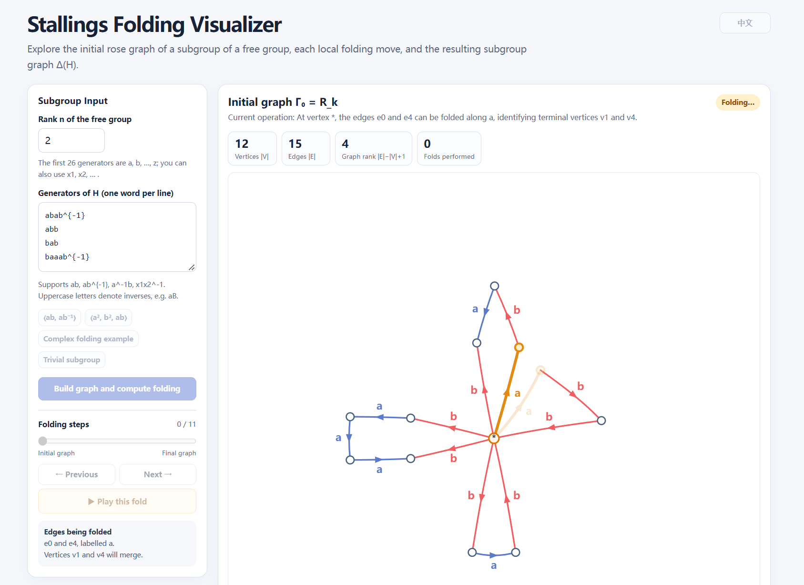

# Stallings Folding Visualizer

A small interactive tool for visualizing Stallings folding, with step-by-step animations and Chinese/English support.

Built with the help of ChatGPT. Made for exploring and learning geometric group theory.

## Example

Here's an example from *Office Hours with a Geometric Group Theorist* that I'm currently reading.

**Free group rank:** `2`

**Subgroup generators:**

```text
abab^{-1}
abb
bab
baaab^{-1}
```

Enter these four words, one per line, and click **Build Graph and Compute Folding** to construct the initial graph.

You can then step through the folding process or play the animations to see how the graph changes at each step.

🌐 [Try it here](https://tojyc.github.io/Stallings_folding_visualizer/)


